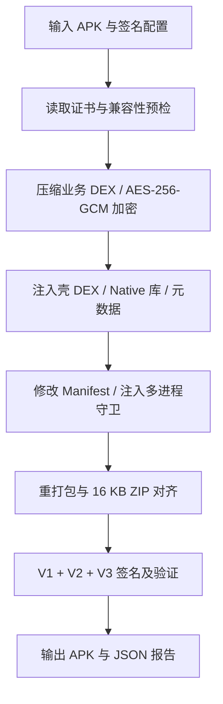

# 加固机制与兼容性

[返回 README](../README.md) · [常见问题](FAQ.md) · [开发验证](development.md)

## 输入条件

当前加固流程以完整 APK 为输入，不依赖业务工程。根据 [ProductionHardenPipeline.kt](../src/main/kotlin/com/apkharden/packager/core/ProductionHardenPipeline.kt) 的预检，输入需满足：

- 文件存在，且输出路径不同于输入路径。
- `minSdk >= 23`，即 Android 6.0 及以上。
- 不是 Split APK，没有开启 `testOnly` 或 `debuggable`。
- 存在业务 DEX，且不是旧版 ProxyApplication 壳的重复加固输入。
- 如果输入 APK 的签名验证有效，需只有一个签名者、不含签名轮换链，并与选择的 keystore 证书一致。

建议始终使用原始发布 APK 与对应发布签名，不使用拆分包、调试包或已加固产物作为再次加固输入。

## 加固流程



| 机制 | 作用 |
| --- | --- |
| 每包随机密钥 | 每个输出 APK 使用独立 AES-256-GCM 密钥，业务 DEX 压缩后认证加密 |
| Native 解密库 | 密钥注入对应 ABI 的 `libapkharden.so`，运行时参与解密；密文篡改导致认证失败 |
| 壳 DEX | 输出保留公开的壳 `classes.dex`，业务 DEX 存储为加密载荷 |
| 签名绑定 | 运行时校验签名 SHA-256，避免直接换证书重打包后正常运行 |
| 基础反调试 | 检查调试器、TracerPid 与 debuggable 状态 |
| 多进程守卫 | 为主进程和 Manifest 中显式声明的业务进程注入非导出 Guard Provider |
| Native 搜索路径 | ClassLoader 兼容安装目录及 `apk!/lib/<abi>` 路径，处理 `extractNativeLibs=false` 的业务库加载 |
| 发布校验 | 验证输出签名、签名身份、守卫配置及公开 DEX 数量，并生成报告 |

源码入口：[ProductionHardenPipeline](../src/main/kotlin/com/apkharden/packager/core/ProductionHardenPipeline.kt)、[DexPayloadCodec](../src/main/kotlin/com/apkharden/packager/core/DexPayloadCodec.kt)、[ApkRepackager](../src/main/kotlin/com/apkharden/packager/core/ApkRepackager.kt)、[shell](../shell)、[guard](../guard)、[native](../native)。

## Android 运行时分支

| 环境 | 加载方式 |
| --- | --- |
| Android 10 / API 29 及以上 | 通过公开的 AppComponentFactory 接入 InMemoryDexClassLoader，从内存加载解密后的 DEX |
| Android 6–9 / API 23–28 | 使用应用私有目录中的版本隔离 DEX 缓存，加载前设置只读，并按元数据复验长度和 SHA-256 |

运行时逐个 DEX 解密，并清零已使用的临时数组，避免同时保留所有明文 DEX。旧版本兼容缓存属于设计的一部分，因此不能将所有 Android 版本都描述为“完全不落盘”。

## 桌面与命令行

桌面流程：签名百宝箱验证并保存 keystore → APK 加固选择输入和输出 → 开始加固并签名。

CLI 可复用同一用户的已保存配置：

```sh
./gradlew harden --args="--input app.apk --output app-hardened.apk --savedProfile true"
```

没有可复用配置时，CLI 参数集合为：

| 参数 | 含义 |
| --- | --- |
| `--input` | 原始 APK 路径，必填 |
| `--output` | 输出 APK 路径，必填 |
| `--savedProfile true` | 使用当前用户已保存的签名资料 |
| `--keystore` | 显式指定 keystore 路径 |
| `--storePass` | keystore 密码 |
| `--alias` | 私钥别名 |
| `--keyPass` | 私钥密码 |

不使用 `--savedProfile true` 时需提供四项显式签名参数。命令行密码可能进入历史或进程参数，常规本机使用优先选择已保存配置。路径包含空格时，需按当前 shell 和 Gradle `--args` 的规则引用。

示例输出：

```text
app-hardened.apk
app-hardened-report.json
```

JSON 报告包含文件摘要、签名证书、包信息、守卫进程与保护项等信息。正式发布前应继续执行目标设备的安装、冷启动与业务回归。

## 兼容性记录

以下为原 README 中保留的历史安装与冷启动记录，**不是本次界面和文档更新重新执行的结果**：

| 环境 | 历史记录范围 |
| --- | --- |
| API 26 / x86 模拟器 | Provider、原 Application、Activity、多 DEX |
| API 28 / ARMv7 转译模拟器 | 32 位业务 APK |
| API 29 / 华为 arm64 真机 / 4 KB | 64 位业务 APK及 MMKV Native 加载 |
| API 36 / 小米 arm64 真机 / 4 KB | 64 位业务 APK |
| API 36 / x86_64 模拟器 / 16 KB | 64 位业务 APK、ARM64 转译 |

仓库另有可查阅的 [2026-09-05 macOS 功能验证记录](macos-verification-2026-09-05.md)，列出了当时使用的测试包、设备、结果和未覆盖项。上述环境不能外推为整个 Android 版本区间或全部厂商设备均已验证。

## 能力边界

- 业务 DEX 在 APK 中不再以原始 `classes*.dex` 明文呈现，但运行时必须解密执行；具备 root、Hook 或内存 Dump 能力的攻击者仍可能脱壳。
- 这是基础 DEX 壳，不包含 VMP、DEX2C、SO 加壳或高强度 Frida / Xposed 对抗。
- ZIP 文件偏移对齐不等于业务 SO 的 ELF 段对齐及完整运行时兼容，不能以打包成功代替 16 KB 页面设备验证。
- 静态多进程守卫覆盖的是 Manifest 中显式声明的进程，不代表所有动态加载和自定义启动链已回归。
- 加固、签名验证通过不等于业务功能验收；需要验证原 Application、Provider、第三方 SDK、Native 库及关键业务流程。

壳初始化失败时，可在 logcat 中检索 `APH-E` 诊断码。修改守卫、壳或 Native 源码后，需[重建壳资源](development.md#重建壳资源)并重新验证。
