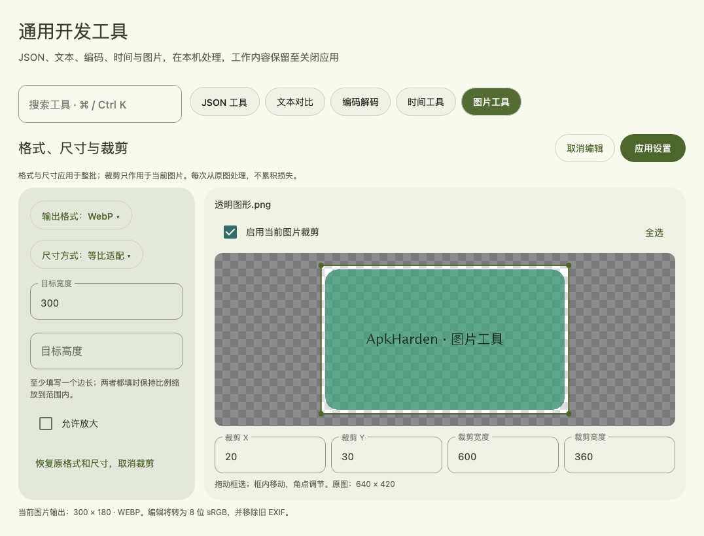
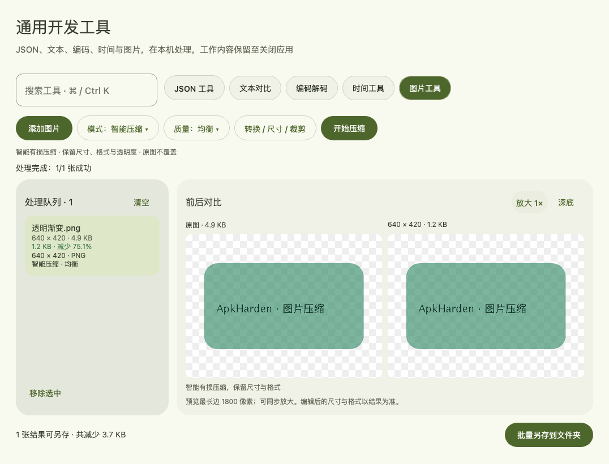
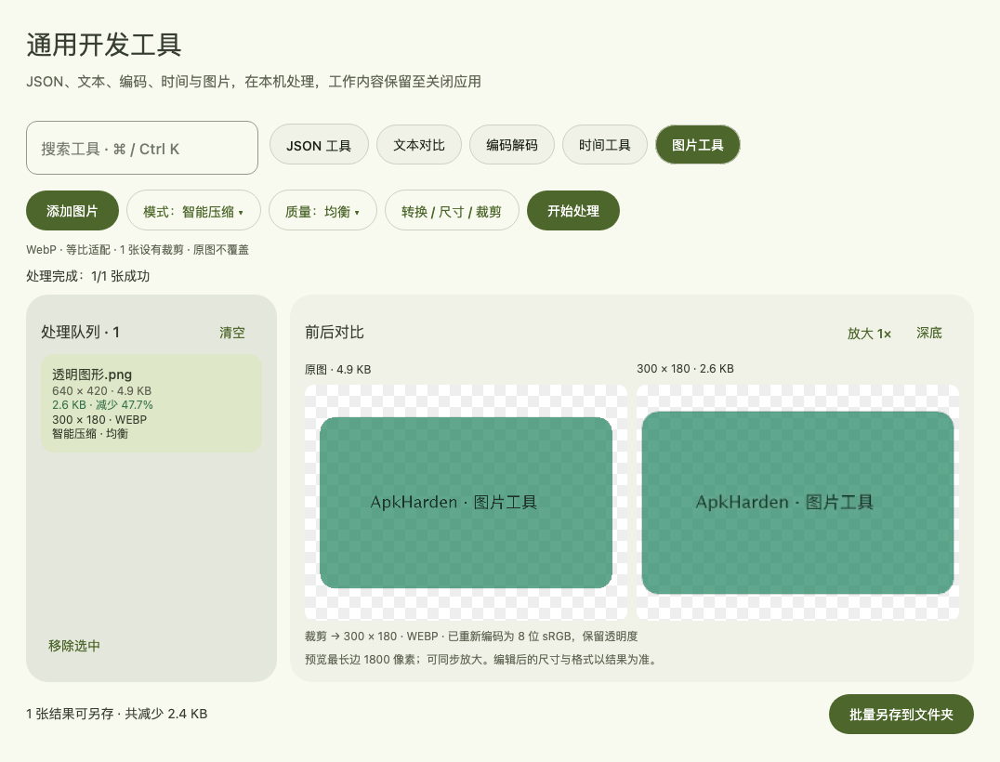

# 本地图片工具

[返回 README](../README.md) · [其他通用工具](developer-tools.md)

入口：**通用工具 → 图片工具**，也可以按 ⌘K / Ctrl+K 搜索“图片”。

## 使用

1. 点击「添加图片」，一次选择多张静态 PNG / JPEG / WebP。
2. 如需转换、缩放或裁剪，选中图片，点击「转换 / 尺寸 / 裁剪」，设置完成后点击「应用设置」。
3. 选择「智能压缩」或「无损优化」及质量，点击「开始压缩」或「开始处理」。
4. 点击队列中的图片查看前后体积、节省比例与画面。可切换浅 / 深棋盘底，按 1× / 2× / 4× 同步放大并滚动。
5. 点击「批量另存到文件夹」。纯压缩输出命名为 `名称-compressed`，编辑结果为 `名称-processed`，扩展名与实际格式一致；重名时追加编号。

原文件不会覆盖。纯压缩结果若不比输入小，保留输入的完整字节；实际发生转换、裁剪或缩放时，即使文件变大也保留编辑结果，不会撤销用户选择的处理。每张图独立处理，单张失败不会中断其余图片；取消会结束当前压缩进程并保留已经完成的结果。更改模式或质量后重新压缩，队列中会标明每份结果实际使用的设置。设置变更后旧结果显示“设置已变更，请重新处理”，并从可导出结果中排除；重新处理成功后恢复导出。

切换通用工具或离开页面不会清空队列，也不会中断压缩。处理采用本机临时快照，源文件随后发生变化不影响这次结果；移除、清空或正常退出会删除工作副本，已经另存的文件继续保留。异常断电或强制结束进程可能留下系统临时文件。

## 格式、尺寸与裁剪

格式和尺寸设置应用于整批图片，裁剪框独立保存在每张图片上。每次都从导入时的原始快照处理，不会在上一次压缩结果上反复损失质量。暂时切换工具会保留未应用的编辑草稿；「取消编辑」才会丢弃本次草稿。

| 功能 | 行为 |
|---|---|
| 格式转换 | PNG、JPEG、WebP 三种格式互转，也可保持每张图片的原格式 |
| 等比适配 | 宽高至少填写一项；同时填写时将图片完整放入目标尺寸内，不补边。默认不放大，可开启允许放大 |
| 指定宽高 | 按给定宽高拉伸，可能改变比例 |
| 百分比 | 在裁剪后尺寸上按 1%–1000% 缩放 |
| 裁剪 | 在校正方向后的图片上拖动框选，框内拖动移动，角点调节大小；也可填写 X、Y、宽度、高度。全选或关闭裁剪可恢复完整范围 |
| JPEG 背景 | 透明区域合成到白色、黑色或自定义 `#RRGGBB` 背景；PNG / WebP 保留透明度 |

固定顺序为：解码与色彩处理、按 EXIF 校正方向、裁剪、缩放、编码输出。实际编辑结果为 8 位 sRGB，不复制旧 EXIF、XMP 等元数据，避免方向或尺寸标签过期。JPEG 编辑后需要有损重编码，即使压缩模式选择无损优化，也会按所选质量生成新的 JPEG；PNG / WebP 在无损模式下不再进行颜色量化。

PNG / WebP 的有效 ICC 色彩配置会用于转换到 sRGB，PNG Gamma 也会处理。使用非标准 cHRM 色度、但没有 ICC 的 PNG 暂不支持预览或编辑，仍可使用原无损压缩流程。16 位 PNG 经编辑后转为 8 位；需要保留原位深时请仅使用无损优化。

输出不能超过 2400 万像素及单边 32768 像素；WebP 单边不超过 16383 像素。预览会显示当前图片预计输出尺寸；混合批次中若某张图片不满足限制，会单独报错，其他图片继续处理。

若配置没有实际改变画面、尺寸或格式（例如 100% 缩放、全图裁剪、同格式输出），使用原压缩流程，保留原元数据。



## 两种模式

| 模式 | PNG | JPEG | WebP |
|---|---|---|---|
| 智能压缩 | pngquant 颜色量化 + OxiPNG 编码优化；保留透明度，像素可能改变 | MozJPEG 重编码；保留尺寸，画质可能改变 | libwebp 有损编码，透明度使用最高质量 |
| 无损优化 | OxiPNG 重排、过滤和压缩；不启用修改透明像素颜色的选项 | MozJPEG jpegtran 优化已有 DCT 系数与渐进扫描，不重新量化 | libwebp 无损编码，保留透明像素的 RGB 值 |

智能模式提供三档：体积优先、均衡（默认）、画质优先。PNG 对应量化质量范围为 65–85 / 80–95 / 90–100；JPEG / WebP 有损编码质量为 82 / 90 / 95。不同编码器的质量数字不可互相比较，也不是视觉质量百分比。

PNG 达不到所选量化质量门槛时回退无损优化。16 位或含 ICC、色度、Gamma、EXIF 配置的 PNG 也走无损路线，以保留色彩解释；不会为了缩小体积直接丢弃配置。JPEG 保留 EXIF（包括方向）、ICC 等元数据；新 JPEG 使用编码器自身的颜色变换标记，避免复制旧 Adobe 标记导致偏色。预览遵循 JPEG EXIF 方向。

仅压缩时保留像素尺寸及文件格式；编辑后显示实际输出尺寸、格式及体积增减，不把缩放收益混称为同尺寸压缩收益。预览为最长边不超过 1800 像素的副本，导出以结果显示的实际尺寸为准。

## 范围与限制

- 支持静态 PNG、WebP、8 位灰度 / 三通道 JPEG；不支持 APNG、动画 WebP、GIF、AVIF、CMYK / 高位深 JPEG，以及含 MPF 多图 / 增益图的 JPEG。
- 单张最大 32 MB、2400 万像素；每批最多 100 张、输入快照总计最多 256 MB。
- 原生引擎每次调用最多 120 秒，超时终止并提示；批次串行处理以控制内存。
- 输入单张最大 32 MB，处理结果最大 128 MB。纯压缩保留原元数据，实际编辑生成新的图像并移除旧元数据。
- 不接入 TinyPNG，不需要 API Key；压缩、预览、导出期间不联网。

## 构建与引擎

当前 macOS 分发包内置以下独立可执行工具，Apple Silicon 已验证：

| 工具 | 版本 | 用途 |
|---|---|---|
| pngquant | 2.18.0，libimagequant 2.17.0 | PNG 颜色量化 |
| OxiPNG | 10.2.1 | PNG 无损优化 |
| MozJPEG | 4.1.1 | JPEG 解码、智能编码和无损优化 |
| libwebp | 1.6.0 | 静态 WebP 编码 / 解码 |
| libpng / zlib | 1.6.55 / 1.3.1 | pngquant 的静态构建依赖 |

macOS 构建需 Xcode 命令行工具及 Python 3。`./gradlew prepareImageTools` 会校验下载文件 SHA-256、从固定源码构建 pngquant / MozJPEG / libwebp，获取对应架构的 OxiPNG，并保留许可证和源码归档。找不到 CMake 时，脚本仅在项目 `build/` 中安装固定版本 CMake，不改动系统安装。首次构建需要网络；应用运行不需要。

`createDistributable` 自动准备并打包引擎。源码运行前可执行：

```sh
./gradlew prepareImageTools run
```

Windows / Linux 尚未自动打包及验证图片引擎。可设置 `APK_HARDEN_IMAGE_TOOLS` 指向包含 `pngquant`、`oxipng`、`cjpeg`、`djpeg`、`jpegtran`、`cwebp`、`dwebp` 的本机目录（Windows 带 `.exe`），并提供其运行依赖。缺少引擎时页面列出缺失项并禁用压缩，其他工具可继续使用。

pngquant / libimagequant 作为独立命令行程序运行，保留各自许可证；macOS 包的 `Contents/app/resources/image-tools/licenses/` 包含对应源码、构建脚本及版权说明。其余引擎也保留上游许可；项目根目录许可证不替代这些第三方许可。

## 验证记录（2026-10-28）

均衡档，输入 / 输出保持相同尺寸与格式，文件大小单位为字节：

| 样本 | 输入 | 智能压缩 | 节省 | 无损优化 | 节省 |
|---|---:|---:|---:|---:|---:|
| 仓库 JSON 界面截图，从 JPEG 解码为 PNG | 583,370 | 186,919 | 68.0% | 482,296 | 17.3% |
| MozJPEG 的 120×96 BMP 照片样本，以质量 98 保存为 JPEG | 18,455 | 11,557 | 37.4% | 14,344 | 22.3% |
| 人工渐变、透明度及文字 PNG | 502,373 | 4,882 | 99.0% | 4,882 | 99.0% |

人工样本的 PNG 原编码有很大优化空间，99% 不能代表普通图片。以上不是与 TinyPNG 的同图对照；没有将这些文件上传到 TinyPNG，也不承诺固定节省比例。

新增验证覆盖三种格式的六个转换方向、WebP 透明度往返、ICC 转换、方向校正后裁剪、等比 / 拉伸 / 百分比缩放、JPEG 背景色、编辑后变大结果保留、越界拒绝及取消清理。界面自动化验证了框选、移动、角点调整、精确输入、单张裁剪与批量设置、取消编辑及旧结果导出拦截。

原压缩测试覆盖无损像素一致性、透明度、EXIF 方向、16 位 PNG 回退、输入快照、重名导出、取消原生进程、异常图片和文件清理。Compose 桌面自动化覆盖实际页面组件中的批量处理、模式切换、导航后恢复、放大、浅深主题、最小窗口及另存流程；系统文件选择器的人工点击不属于该自动化覆盖。

```sh
./gradlew test --tests 'com.apkharden.packager.core.image.*'
```

测试产物位于 `build/image-compression-report/` 与 `build/image-ui-test/`。当前演示页面由实际 Compose 组件自动渲染，输入为测试用的透明图形。





WebP 引擎参数参考：[cwebp](https://developers.google.com/speed/webp/docs/cwebp)、[dwebp](https://developers.google.com/speed/webp/docs/dwebp)。
